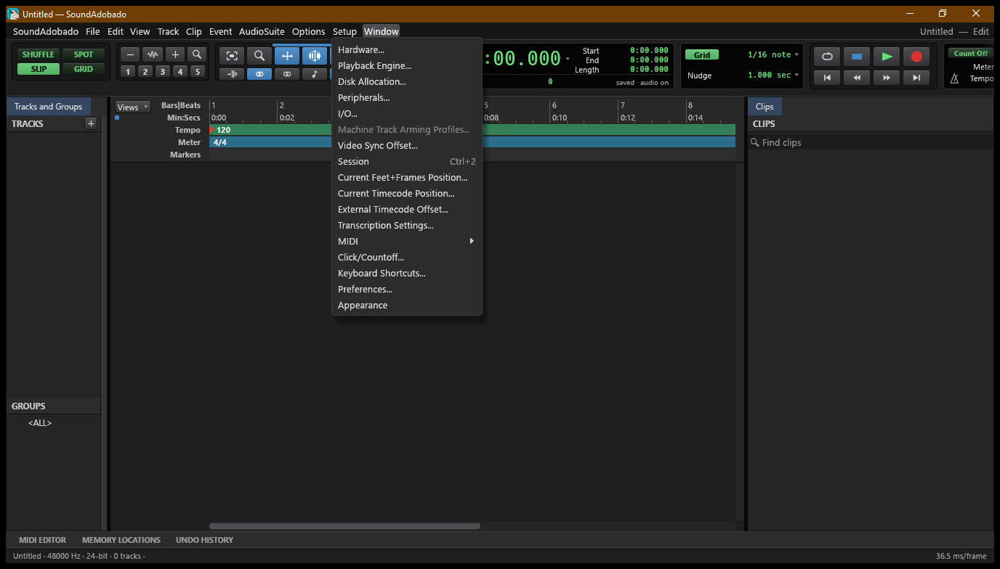

# SoundAdobado

**Audio local.** Derivado de SoundCraft, rebrandeado para Adobado Kit.

> **Prueba de humo superada en Windows (20/10/2026).** Build de Windows correcta y app instalada y abierta en el PC. La prueba de abrir, modificar y exportar un archivo real sigue pendiente; el proyecto continúa en alpha.
>
> Proyecto independiente. No afiliado a ArtCraft ni a Adobe.

Captura real de la aplicación en Windows.

## Estado

- **Build de Windows:** correcto en GitHub Actions; consulta el [workflow actual](https://github.com/smouj/SoundAdobado/actions/workflows/windows-build.yml).
- **Prueba manual:** instalada y abierta en Windows el 20/10/2026.
- **Flujo funcional:** abrir, modificar y exportar un archivo real sigue pendiente.
- **Disponibilidad:** alpha; todavía no se declara lista para uso general.
- **Release pública:** [v0.1.0-alpha.1](https://github.com/smouj/SoundAdobado/releases/tag/v0.1.0-alpha.1) se publicó antes de la identidad visual actual y conserva el icono anterior. El ZIP se actualizará después de verificar el icono integrado y la prueba funcional.
- **Commit de origen:** 25d52c646aea780c8076ff966076f994ad256221.

## Build

Requisitos: Rust 1.95 o superior.

    cargo build --release -p soundcraft

El nombre interno del crate se conserva para no romper el workspace; el nombre de producto visible es SoundAdobado.

## Procedencia y licencias

- Upstream: https://github.com/storytold/soundcraft
- Commit base: 25d52c646aea780c8076ff966076f994ad256221
- Licencia: MIT OR Apache-2.0. Se conservan los archivos de licencia, NOTICE y ATTRIBUTION del upstream.
- Cambios: docs/ADOBADO.md.
- La marca, el wordmark y los logos de ArtCraft no estan cubiertos por la licencia y se retiran de la distribucion.

## Adobado Kit

Este repo forma parte de Adobado Kit: https://github.com/smouj/Adobado_Kit

Hecho por SMOUJ013.
